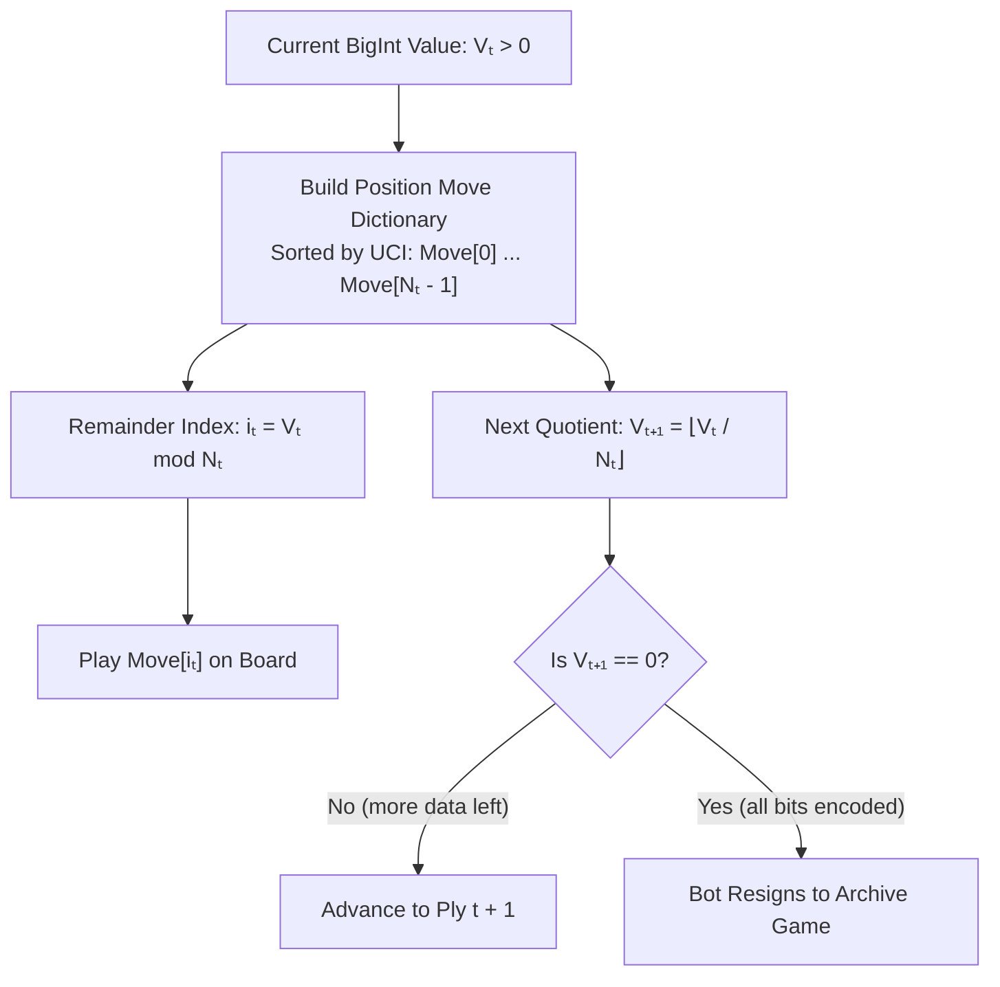

# ChessCrypt ♟️🔐

**Store arbitrary data inside legal chess games played between two unrated bots on [Lichess.org](https://lichess.org).**

ChessCrypt converts any text or binary file into a sequence of **100% legal chess moves** using **Mixed-Radix Combinatorial Steganography** (with optional PBKDF2 + SHA-256-CTR + HMAC authenticated encryption). Two unrated Lichess bots—**`RookCipherBot`** (White) and **`PawnVaultBot`** (Black)—challenge each other via the official Lichess Bot API, play the encoded moves in lockstep, and archive the match permanently on Lichess.

---

## 1. Visual Architecture & How It Works

### End-to-End Storage & Retrieval Flow

```mermaid
flowchart LR
    subgraph Encode["1. Encrypt & Encode"]
        A["Plaintext\n'Hello World'"] --> B["Optional Crypto\n(PBKDF2 + HMAC)"]
        B --> C["Sentinel BigInt (V₀)\n0x01 + payload bytes"]
        C --> D["Mixed-Radix Encoder\niₜ = Vₜ mod Nₜ\nVₜ₊₁ = ⌊Vₜ / Nₜ⌋"]
    end

    subgraph Lichess["2. Unrated Lichess Bot Match"]
        D --> E["RookCipherBot (White)\nChallenges (rated=false)"]
        E <--> F["PawnVaultBot (Black)\nAccepts & Alternates Moves"]
        F --> G[("Lichess Game Archive\nhttps://lichess.org/{gameId}")]
    end

    subgraph Decode["3. Fetch & Decrypt"]
        G --> H["Download PGN\nGET /game/export/{gameId}"]
        H --> I["Position Dictionary Lookup\nV₀ = Σ iₜ · Π Nⱼ"]
        I --> J["Strip 0x01 Sentinel\n& Verify HMAC"]
        J --> K["Recovered Data\n'Hello World'"]
    end
```



### How Each Half-Move (Ply) Encodes Data

At any chess position at ply $t$, both the encoder and decoder run the exact same legal move generator (`chesscrypt.dictionary.get_position_dictionary`):

1. Generate all legal moves in the current board position.
2. Filter out terminal moves that would prematurely end the game (accidental checkmate, stalemate, 50-move rule, threefold repetition, or forced 1-ply dead ends).
3. Sort the remaining $N_t$ safe legal moves **lexicographically by UCI notation** (`a2a3`, `a2a4`, `b1a3`, `b1c3`, …).
4. Index them `0` through $N_t - 1$. Because an average chess position has $N_t \approx 25\text{–}35$ legal moves, each half-move stores $\log_2(N_t) \approx \mathbf{4.6\text{ to }5.1\text{ bits}}$ of data.



---

## 2. The ChessCrypt Move Dictionary Guide

Unlike a static substitution cipher (where `e4` always means the same byte), chess legal moves change after every turn. ChessCrypt uses a **Deterministic Position Dictionary**: given any board state (FEN), the dictionary is reconstructed on the fly without ever needing to transmit it.

### Opening Position Dictionary (Ply 1 — White to Move, $N_1 = 20$)

In the starting position (`rnbqkbnr/pppppppp/8/8/8/8/PPPPPPPP/RNBQKBNR w KQkq - 0 1`), White has **20 legal moves** ($\approx 4.32\text{ bits}$ of capacity):

| Dictionary Index (`i`) | UCI Move | SAN Move | Piece | From $\to$ To | Binary Value ($\approx 4.32\text{ b}$) |
| :---: | :---: | :---: | :--- | :---: | :---: |
| **`0`** | `a2a3` | **a3** | Pawn | `a2 -> a3` | `00000` |
| **`1`** | `a2a4` | **a4** | Pawn | `a2 -> a4` | `00001` |
| **`2`** | `b1a3` | **Na3** | Knight | `b1 -> a3` | `00010` |
| **`3`** | `b1c3` | **Nc3** | Knight | `b1 -> c3` | `00011` |
| **`4`** | `b2b3` | **b3** | Pawn | `b2 -> b3` | `00100` |
| **`5`** | `b2b4` | **b4** | Pawn | `b2 -> b4` | `00101` |
| **`6`** | `c2c3` | **c3** | Pawn | `c2 -> c3` | `00110` |
| **`7`** | `c2c4` | **c4** | Pawn | `c2 -> c4` | `00111` |
| **`8`** | `d2d3` | **d3** | Pawn | `d2 -> d3` | `01000` |
| **`9`** | `d2d4` | **d4** | Pawn | `d2 -> d4` | `01001` |
| **`10`** | `e2e3` | **e3** | Pawn | `e2 -> e3` | `01010` |
| **`11`** | `e2e4` | **e4** | Pawn | `e2 -> e4` | `01011` |
| **`12`** | `f2f3` | **f3** | Pawn | `f2 -> f3` | `01100` |
| **`13`** | `f2f4` | **f4** | Pawn | `f2 -> f4` | `01101` |
| **`14`** | `g1f3` | **Nf3** | Knight | `g1 -> f3` | `01110` |
| **`15`** | `g1h3` | **Nh3** | Knight | `g1 -> h3` | `01111` |
| **`16`** | `g2g3` | **g3** | Pawn | `g2 -> g3` | `10000` |
| **`17`** | `g2g4` | **g4** | Pawn | `g2 -> g4` | `10001` |
| **`18`** | `h2h3` | **h3** | Pawn | `h2 -> h3` | `10010` |
| **`19`** | `h2h4` | **h4** | Pawn | `h2 -> h4` | `10011` |

### Response Position Dictionary (Ply 2 — Black to Move after `1. d3`, $N_2 = 20$)

Once White plays `1. d3` (index `8`), it is Black's turn. The dictionary automatically updates to Black's 20 sorted legal moves:

| Index (`i`) | `0` | `1` | `2` | **`3`** | `4` | `5` | `6` | `7` | `8` | `9` | `10` | `11` | `12` | `13` | `14` | `15` | `16` | `17` | `18` | `19` |
| :---: | :-: | :-: | :-: | :-: | :-: | :-: | :-: | :-: | :-: | :-: | :-: | :-: | :-: | :-: | :-: | :-: | :-: | :-: | :-: | :-: |
| **UCI** | `a7a5` | `a7a6` | `b7b5` | **`b7b6`** | `b8a6` | `b8c6` | `c7c5` | `c7c6` | `d7d5` | `d7d6` | `e7e5` | `e7e6` | `f7f5` | `f7f6` | `g7g5` | `g7g6` | `g8f6` | `g8h6` | `h7h5` | `h7h6` |
| **SAN** | a5 | a6 | b5 | **b6** | Na6 | Nc6 | c5 | c6 | d5 | d6 | e5 | e6 | f5 | f6 | g5 | g6 | Nf6 | Nh6 | h5 | h6 |

> [!TIP]
> You can inspect the Move Dictionary for **any** chess position at any time with:
> ```bash
> python -m chesscrypt dictionary --fen "rnbqkbnr/pppppppp/8/8/8/3P4/PPP1PPPP/RNBQKBNR b KQkq - 0 1"
> ```

---

## 3. Worked Example: Encrypting & Decrypting `"Hello World"`

### Step 1: Convert `"Hello World"` into a Self-Delimiting BigInt ($V_0$)

First, we take the 11 UTF-8 bytes of `"Hello World"` and prepend a `0x01` sentinel byte (so leading `0x00` bytes are never lost):

| Character | *Sentinel* | `H` | `e` | `l` | `l` | `o` | ` ` | `W` | `o` | `r` | `l` | `d` |
| :--- | :---: | :---: | :---: | :---: | :---: | :---: | :---: | :---: | :---: | :---: | :---: | :---: |
| **Hex Byte** | **`01`** | `48` | `65` | `6c` | `6c` | `6f` | `20` | `57` | `6f` | `72` | `6c` | `64` |

Interpreted as a big-endian integer (`0x0148656c6c6f20576f726c64`):

$$V_0 = \mathbf{39,700,662,791,022,760,251,689,6868}$$

### Step 2: Ply-by-Ply Mixed-Radix Encoding into Chess Moves

At each ply $t$, we divide $V_{t-1}$ by the number of legal moves $N_t$:
- **Remainder** $i_t = V_{t-1} \bmod N_t$ selects the move from the Position Dictionary.
- **Quotient** $V_t = \lfloor V_{t-1} / N_t \rfloor$ becomes the input for the next ply until $V_t = 0$.

| Ply | Move | Turn | Legal Moves ($N_t$) | Dictionary Index ($i_t = V_{t-1} \bmod N_t$) | UCI | SAN | Piece | Remaining Quotient ($V_t = \lfloor V_{t-1} / N_t \rfloor$) |
| :-: | :-: | :-: | :-: | :-: | :-: | :-: | :-: | :--- |
| **1** | `1.` | White | 20 | **`8`** | `d2d3` | **d3** | Pawn | `19850331395511380125844843` |
| **2** | `1...` | Black | 20 | **`3`** | `b7b6` | **b6** | Pawn | `992516569775569006292242` |
| **3** | `2.` | White | 27 | **`19`** | `f2f3` | **f3** | Pawn | `36759872954650703936749` |
| **4** | `2...` | Black | 21 | **`13`** | `f7f5` | **f5** | Pawn | `1750470140697652568416` |
| **5** | `3.` | White | 26 | **`14`** | `d1d2` | **Qd2** | Queen | `67325774642217406477` |
| **6** | `3...` | Black | 21 | **`1`** | `a7a6` | **a6** | Pawn | `3205989268677019356` |
| **7** | `4.` | White | 27 | **`6`** | `c2c3` | **c3** | Pawn | `118740343284334050` |
| **8** | `4...` | Black | 19 | **`5`** | `c7c6` | **c6** | Pawn | `6249491751807055` |
| **9** | `5.` | White | 23 | **`6`** | `d2c2` | **Qc2** | Queen | `271717032687263` |
| **10** | `5...` | Black | 18 | **`17`** | `h7h6` | **h6** | Pawn | `15095390704847` |
| **11** | `6.` | White | 28 | **`19`** | `e1f2` | **Kf2** | King | `539121096601` |
| **12** | `6...` | Black | 17 | **`7`** | `d8c7` | **Qc7** | Queen | `31713005682` |
| **13** | `7.` | White | 27 | **`0`** | `a2a3` | **a3** | Pawn | `1174555766` |
| **14** | `7...` | Black | 25 | **`16`** | `e7e6` | **e6** | Pawn | `46982230` |
| **15** | `8.` | White | 26 | **`22`** | `g2g3` | **g3** | Pawn | `1807008` |
| **16** | `8...` | Black | 30 | **`18`** | `f5f4` | **f4** | Pawn | `60233` |
| **17** | `9.` | White | 25 | **`8`** | `c2a4` | **Qa4** | Queen | `2409` |
| **18** | `9...` | Black | 28 | **`1`** | `a8a7` | **Ra7** | Rook | `86` |
| **19** | `10.` | White | 32 | **`22`** | `e2e4` | **e4** | Pawn | `2` |
| **20** | `10...` | Black | 29 | **`2`** | `a7b7` | **Rb7** | Rook | **`0` (Done!)** |

### Step 3: Resulting Chess Game & Final Board Position

The entire `"Hello World"` string is stored in a 10-move (20-ply) game between **`RookCipherBot`** and **`PawnVaultBot`**:

```pgn
[Event "ChessCrypt Unrated Bot Storage"]
[Site "https://lichess.org"]
[Date "2026.11.19"]
[Round "1/1"]
[White "RookCipherBot"]
[Black "PawnVaultBot"]
[Result "*"]

1. d3 b6 2. f3 f5 3. Qd2 a6 4. c3 c6 5. Qc2 h6 6. Kf2 Qc7 7. a3 e6 8. g3 f4 9. Qa4 Ra7 10. e4 Rb7 *
```

```text
Final Board after 10... Rb7:
  +------------------------+
8 | .  n  b  .  k  b  n  r |
7 | .  r  q  p  .  .  p  . |
6 | p  p  p  .  p  .  .  p |
5 | .  .  .  .  .  .  .  . |
4 | Q  .  .  .  P  p  .  . |
3 | P  .  P  P  .  P  P  . |
2 | .  P  .  .  .  K  .  P |
1 | R  N  B  .  .  B  N  R |
  +------------------------+
    a  b  c  d  e  f  g  h
```

### Step 4: Decrypting the Game Back to `"Hello World"`

To decode the PGN, the decoder replays each move from the starting board, looks up the move's dictionary index $i_t$ and radix $N_t$, and accumulates:

$$V_0 = \sum_{t=1}^{20} i_t \cdot \left(\prod_{j=1}^{t-1} N_j\right)$$

$$V_0 = 8\times 1 + 3\times 20 + 19\times(20\cdot 20) + 13\times(20\cdot 20\cdot 27) + \dots + 2\times\left(\prod_{j=1}^{19} N_j\right) = \mathbf{39,700,662,791,022,760,251,689,6868}$$

Converting $V_0$ back to hex gives `01 48 65 6c 6c 6f 20 57 6f 72 6c 64`. Stripping the leading `0x01` sentinel yields:

$$\texttt{48 65 6c 6c 6f 20 57 6f 72 6c 64} \implies \mathbf{\text{"Hello World"}}$$

---

## 4. Unrated Lichess Bot Setup (`RookCipherBot` & `PawnVaultBot`)

We chose two dedicated, available Lichess bot usernames for ChessCrypt:
- **White Bot (Challenger / Sender):** `RookCipherBot`
- **Black Bot (Acceptor / Receiver):** `PawnVaultBot`

> [!IMPORTANT]
> **Why Unrated Games?**  
> Pre-arranged games between two accounts you control must **always** be played as **unrated (`rated=false`)** casual matches. ChessCrypt strictly enforces `rated=False` at the API level so that neither bot affects Lichess rating pools while still archiving every game permanently at `https://lichess.org/{gameId}`.

### Connecting Live Lichess Bots in 3 Steps

Because Lichess requires human registration + email confirmation for new accounts (and does not provide an account creation API), complete the initial signup once in your browser, and ChessCrypt handles the `BOT` account upgrade and match play automatically:

1. **Register the two accounts** at [https://lichess.org/signup](https://lichess.org/signup) (do **not** play any human games on them, as Lichess only allows accounts with 0 games played to upgrade to `BOT` status):
   - Account 1: `RookCipherBot`
   - Account 2: `PawnVaultBot`
2. **Generate Personal Access Tokens** for both accounts at [https://lichess.org/account/oauth/token/create](https://lichess.org/account/oauth/token/create) with scopes:
   - `bot:play` (*Play games with the bot API*)
   - `challenge:read` & `challenge:write` (*Create, accept, decline challenges*)
3. **Configure `.env` and run `setup-bots`**:
   ```bash
   cp .env.example .env
   # Paste LICHESS_WHITE_BOT_TOKEN and LICHESS_BLACK_BOT_TOKEN into .env
   python -m chesscrypt setup-bots
   ```
   This calls `POST https://lichess.org/api/bot/account/upgrade` on both accounts to upgrade them to official **`BOT`** status.

---

## 5. CLI Quickstart & Commands

### Run the `"Hello World"` Encrypt + Unrated Bot Match + Decrypt Demo
```bash
python -m chesscrypt demo
```

### Encode Any Text (with Optional Passphrase Encryption)
```bash
# Plain mixed-radix encoding with ply-by-ply dictionary trace:
python -m chesscrypt encode "Hello World" --trace

# Authenticated encryption with a secret passphrase before encoding into moves:
python -m chesscrypt encode "Hello World" --passphrase "my-secret-key" -o secret.pgn
```

### Decode a PGN File Back to Text
```bash
python -m chesscrypt decode -f secret.pgn --passphrase "my-secret-key"
```

### Play an Unrated Bot Match to Store Data (Simulated or Live Lichess)
```bash
# Run locally on the built-in Lichess Bot Simulator:
python -m chesscrypt store-lichess "Hello World" --simulate

# Run live between RookCipherBot and PawnVaultBot on lichess.org:
python -m chesscrypt store-lichess "Hello World"
```

### Run the Test Suite
```bash
pytest -v
```
