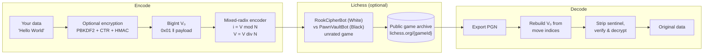

<div align="center">

# ♟️ ChessCrypt

**Hide any data inside perfectly legal chess games, and archive it on Lichess.**

[](https://www.python.org/)
[](https://python-chess.readthedocs.io/)
[](https://docs.pytest.org/)
[](https://lichess.org/api#tag/Bot)

[How it works](#how-it-works) · [Installation](#installation) · [Quick start](#quick-start) · [Lichess storage](#storing-data-on-lichess) · [CLI reference](#cli-reference) · [Python API](#python-api) · [Technical guide](TECHNICAL_GUIDE.md)

</div>

---

ChessCrypt turns arbitrary bytes (a message, a key, a small file) into a sequence of **legal chess moves**. Every move choice encodes part of a big integer, so the game *is* the data. Optionally encrypt the payload with a passphrase first, then have two unrated bot accounts play the game out on [Lichess](https://lichess.org). The result is a public, permanent game archive that anyone can browse and that only ChessCrypt can turn back into your data.

```text
$ chesscrypt encode "Hello World"
[Event "ChessCrypt Unrated Bot Storage"]
[Site "https://lichess.org"]
[Date "2026.11.20"]
[Round "1/1"]
[White "RookCipherBot"]
[Black "PawnVaultBot"]
[Result "*"]

1. d3 b6 2. f3 f5 3. Qd2 a6 4. c3 c6 5. Qc2 h6 6. Kf2 Qc7 7. a3 e6 8. g3 f4 9.
Qa4 Ra7 10. e4 Rb7 *
```

## Highlights

- **Lossless and deterministic.** Any byte string, including empty input and leading `0x00` bytes, round-trips exactly. No lookup tables or keys need to be shared besides the optional passphrase.
- **Near-optimal density.** Mixed-radix big-integer arithmetic uses the full branching factor of every position, about **4.9 bits per ply** on average.
- **Always a legal, ongoing game.** Moves that would end the game (checkmate, stalemate, insufficient material, or a claimable 50-move or threefold draw) are filtered out of the dictionary, so the game is still in progress when the last encoded move is played.
- **Optional authenticated encryption.** PBKDF2-HMAC-SHA256 key derivation, a SHA-256-CTR keystream and an HMAC-SHA256 tag. A wrong passphrase or a tampered game is detected rather than decoded into garbage.
- **Lichess integration.** Two bot accounts play **unrated** games through the official Bot API; anyone can later fetch them by game ID and decode them.
- **Offline simulator.** The full challenge, play, export and decode cycle runs locally without tokens, both for the demo and for the test suite.
- **Terminal viewer.** Watch the game being encoded on an animated, Lichess-themed 2D board next to the live move dictionary.

## How it works



1. **Bytes become one integer.** A `0x01` sentinel byte is prepended to the payload and the whole thing is read as a big-endian integer `V`. The sentinel preserves leading zero bytes and guarantees `V ≥ 1`.
2. **Every position becomes a dictionary.** At each ply, ChessCrypt lists the safe legal moves and sorts them by UCI notation (`a2a3`, `a2a4`, `b1a3`, …), numbering them `0 … N-1`. In the starting position, `N = 20`.
3. **Divide and play.** It plays move number `V mod N`, sets `V = V div N`, and repeats on the new position until `V` reaches 0.
4. **Decoding runs it backwards.** Replay the game from move 1, look up each move's index in the same dictionary, and multiply the indices back together to recover `V`, and from it the original bytes.

For `"Hello World"`, the first move is index `397006627910227602516896868 mod 20 = 8`, which is `d3`:

```text
    +------------------------+    [BOT] PawnVaultBot (Black)
  8 | r  n  b  q  k  b  n  r |    ------------------------------------------------
  7 | p  p  p  p  p  p  p  p |    Progress   : [#...................]   5% (1/20)
  6 | .  .  .  .  .  .  .  . |    Ply        : 1 / 20 (White)
  5 | .  .  .  .  .  .  .  . |    Move Played: 1. d3 (d2d3) [Pawn]
  4 | .  .  .  .  .  .  .  . |    Dict Radix : N = 20 legal moves (4.32 bits)
  3 | .  .  . [P] .  .  .  . |    Dict Index : i = V mod 20 = [8]
  2 | P  P  P [.] P  P  P  P |    V (before) : 397006627910227602516896868
  1 | R  N  B  Q  K  B  N  R |    V (after)  : 19850331395511380125844843
    +------------------------+    Moves      : [1.d3]
      a  b  c  d  e  f  g  h      ------------------------------------------------
                                  [BOT] RookCipherBot (White) <-- moved
  -- Position Move Dictionary at Ply 1 (Sorted by UCI, N = 20) --
    [ 0] a3   (a2a3)     [ 1] a4   (a2a4)     [ 2] Na3  (b1a3)     [ 3] Nc3  (b1c3)
    [ 4] b3   (b2b3)     [ 5] b4   (b2b4)     [ 6] c3   (c2c3)     [ 7] c4   (c2c4)
  >>[ 8] d3   (d2d3)<<   [ 9] d4   (d2d4)     [10] e3   (e2e3)     [11] e4   (e2e4)
    [12] f3   (f2f3)     [13] f4   (f2f4)     [14] Nf3  (g1f3)     [15] Nh3  (g1h3)
    [16] g3   (g2g3)     [17] g4   (g2g4)     [18] h3   (h2h3)     [19] h4   (h2h4)
```

*(Output of `chesscrypt demo --no-color`. In a terminal, the demo animates a full-color board instead.)*

The full 20-ply division table, the bijection proof, the encryption format and the capacity analysis are in the **[Technical Guide](TECHNICAL_GUIDE.md)**.

## Installation

ChessCrypt requires **Python 3.10 or newer**.

```bash
git clone https://github.com/RaymonDev/ChessCrypt.git
cd ChessCrypt

python -m venv .venv
source .venv/bin/activate        # Windows: .venv\Scripts\activate

pip install -e ".[dev]"          # installs the `chesscrypt` command and pytest
```

Prefer not to install the package? Run `pip install -r requirements.txt` and use `python -m chesscrypt` wherever this README says `chesscrypt`.

## Quick start

**Watch the demo:** it encodes `"Hello World"`, plays it on an animated board, runs the match on the local Lichess simulator and verifies the decoded result.

```bash
chesscrypt demo                       # animated board
chesscrypt demo --step                # press Enter to advance each ply
chesscrypt demo --message "Attack at dawn!" --passphrase "knight-fork"
```

**Encode and decode text:**

```bash
chesscrypt encode "Attack at dawn!" -o secret.pgn
chesscrypt decode -f secret.pgn
# Attack at dawn!
```

**Encode a binary file with encryption:**

```bash
chesscrypt encode -i id_ed25519.pub --passphrase "knight-fork" -o key.pgn
chesscrypt decode -f key.pgn --passphrase "knight-fork" -o restored.pub
```

**See the math:** `--trace` prints the ply-by-ply division table, and `dictionary` prints the move dictionary of any position.

```bash
chesscrypt encode "Hi" --trace
chesscrypt dictionary --fen "rnbqkbnr/pppppppp/8/8/3P4/8/PPP1PPPP/RNBQKBNR b KQkq - 0 1"
```

> [!TIP]
> Set `CHESSCRYPT_PASSPHRASE` in your environment or `.env` file to avoid typing `--passphrase` on every command.

## Storing data on Lichess

ChessCrypt uses two Lichess **bot** accounts: a white challenger and a black acceptor. The defaults are `RookCipherBot` and `PawnVaultBot`; use your own names via `.env`.

### 1. Create the bot accounts

1. Register two accounts at [lichess.org/signup](https://lichess.org/signup).
   **Do not play any games with them.** Lichess only upgrades accounts with zero games played to bot status.
2. For each account, create a personal access token at [lichess.org/account/oauth/token/create](https://lichess.org/account/oauth/token/create) with these scopes:
   `bot:play`, `challenge:read`, `challenge:write`.

### 2. Configure and upgrade

```bash
cp .env.example .env    # then fill in both tokens (and bot names if you changed them)
chesscrypt setup-bots   # one-time: POST /api/bot/account/upgrade for both accounts
```

### 3. Store and retrieve

```bash
chesscrypt store-lichess "Hello World"
# Stored in Unrated Game: https://lichess.org/AbCd1234 (20 plies)
# ...
# Retrieve with: chesscrypt fetch-lichess AbCd1234

chesscrypt fetch-lichess AbCd1234            # game IDs or full URLs; no token needed
```

Payloads larger than 32 bytes span several games. Pass **all** of the printed IDs to `fetch-lichess`, **in the same order**. Add `--simulate` to `store-lichess` to rehearse the whole flow offline.

> [!NOTE]
> Games are always **unrated**: `create_challenge` refuses `rated=True`, so the bots never affect rating pools. Lichess is a free, donation-funded service, so please keep payloads small. At the default 0.35 s per move, each 32-byte game takes about 20–30 seconds to play.

## CLI reference

| Command | What it does | Useful options |
| :-- | :-- | :-- |
| `chesscrypt demo` | Animated encode → play → decode demo on the local simulator (also the default with no command). | `--message`, `--passphrase`, `--step`, `--all-plies`, `--delay`, `--no-color` |
| `chesscrypt encode [TEXT]` | Encode text (or a file) into PGN. | `-i FILE`, `-o FILE`, `--passphrase`, `--trace`, `--chunk-bytes`, `--white`, `--black` |
| `chesscrypt decode` | Decode PGN from a file, a string or stdin. | `-f FILE`, `--pgn TEXT`, `-o FILE`, `--passphrase` |
| `chesscrypt dictionary` | Print the move dictionary for a position. | `--fen FEN` |
| `chesscrypt setup-bots` | Upgrade both Lichess accounts to bot status. | `--white-token`, `--black-token`, `--white-name`, `--black-name` |
| `chesscrypt store-lichess [TEXT]` | Play the encoded games between the two bots on Lichess. | `-i FILE`, `--passphrase`, `--simulate`, `--move-delay`, `--chunk-bytes` |
| `chesscrypt fetch-lichess GAME…` | Download games by ID or URL and decode them. | `--passphrase`, `-o FILE` |

Run `chesscrypt <command> --help` for every option. Errors are reported as a single `chesscrypt: error: …` line with exit code `1`.

**Environment variables** (read from the environment or a `.env` file):

| Variable | Purpose |
| :-- | :-- |
| `LICHESS_WHITE_BOT_TOKEN` / `LICHESS_BLACK_BOT_TOKEN` | Personal access tokens for the two bot accounts. |
| `LICHESS_WHITE_BOT_NAME` / `LICHESS_BLACK_BOT_NAME` | Bot usernames (default `RookCipherBot` / `PawnVaultBot`). |
| `CHESSCRYPT_PASSPHRASE` | Default passphrase for `encode`, `decode`, `store-lichess` and `fetch-lichess`. |

## Python API

```python
from chesscrypt import encode_text, encode_bytes, decode_pgn

games = encode_text("Attack at dawn", passphrase="knight-fork")
pgn = "\n\n".join(game.to_pgn() for game in games)

result = decode_pgn(pgn, passphrase="knight-fork")
print(result.text)               # "Attack at dawn"

# Binary data works the same way:
games = encode_bytes(open("logo.png", "rb").read())
```

Each `EncodedGame` exposes `uci_moves`, `san_moves`, `to_pgn()` and a per-ply `traces` list; `format_trace_markdown()` renders the trace table. To drive real or simulated bots, see `LichessMatchOrchestrator`, `LichessBotClient` and `SimulatedLichessServer` in [`chesscrypt/lichess.py`](chesscrypt/lichess.py).

## Capacity and performance

| Measure | Value |
| :-- | :-- |
| Average density | ≈ 4.9 bits per ply (random data) |
| `"Hello World"` (11 bytes) | 1 game, 20 plies |
| One full game (32-byte chunk) | ≈ 53 plies (51–56), about 27 moves |
| Encryption overhead | +16 bytes per message (8-byte salt + 8-byte tag), ≈ 26 plies |
| 1 KiB payload | 32 games, ≈ 1,700 plies |
| Encode / decode speed | ≈ 5 ms per ply on a modern desktop CPU |

## Security notes

- **Without a passphrase, ChessCrypt is an encoding, not encryption.** Anyone who knows ChessCrypt can decode an unencrypted game.
- **With a passphrase**, the payload is encrypted and authenticated before encoding. The format favors compactness: an 8-byte salt, a 64-bit tag and 100,000 PBKDF2 iterations. That is fine for casual use, but below the margins of standard AEAD constructions. Use a long, random passphrase, and don't rely on ChessCrypt for high-value secrets. See [section 3 of the Technical Guide](TECHNICAL_GUIDE.md#3-authenticated-encryption-layer-pbkdf2--sha-256-ctr--hmac) for details.
- **The games are not disguised as human play.** Moves follow your data, not chess strategy, so a stored game is easy to recognize as unusual even though every move is legal.

## Project layout

```text
chesscrypt/
├── dictionary.py   # Deterministic per-position move dictionary (safe moves, UCI-sorted)
├── encoder.py      # Byte ↔ BigInt framing, mixed-radix encode/decode, PGN I/O
├── crypto.py       # Optional PBKDF2 + SHA-256-CTR + HMAC payload encryption
├── lichess.py      # Lichess Bot API client, two-bot orchestrator, offline simulator
├── viewer.py       # 2D terminal board, HUD and dictionary grid
└── cli.py          # `chesscrypt` command-line interface
tests/              # pytest suite (no network access required)
TECHNICAL_GUIDE.md  # Math, proofs, encryption format and protocol details
```

## Development

```bash
pip install -e ".[dev]"
pytest
```

The test suite runs entirely offline: Lichess HTTP calls are mocked and full matches use the built-in simulator. The encoding format is frozen, because changing the move dictionary or the crypto framing would make previously stored games undecodable. Treat any change to `dictionary.py`, `bytes_to_bigint` or `crypto.py` as a breaking format change.
