# ♟️ ChessCrypt — Store Data Inside Legal Chess Games

```text
╭──────────────────────────────────────────────────────────────────────────────────╮
│ ♟  CHESSCRYPT TERMINAL ARENA  •  UNRATED LICHESS BOT STORAGE                     │
│    Bots   : RookCipherBot (White) vs PawnVaultBot (Black)                         │
│    Secret : 'Hello World'  ──►  10 Moves (20 Plies)  ──►  100% Lossless PGN      │
╰──────────────────────────────────────────────────────────────────────────────────╯
```

**ChessCrypt** encodes arbitrary text or binary files into **100% legal chess games** and plays them out between two unrated bots (**`RookCipherBot`** & **`PawnVaultBot`**) on [Lichess.org](https://lichess.org), turning a chess game archive into permanent, public, steganographic cloud storage.

> 📐 **Want the deep math, mixed-radix proofs, and cryptography specs?**  
> Read the full **[Technical Specification & Mathematical Guide (TECHNICAL_GUIDE.md)](./TECHNICAL_GUIDE.md)**.

---

## ✨ Features

* **🖥️ 2D Console Chess Arena:** Watch the encoded game play out live in your terminal on a truecolor Lichess-themed 2D chessboard (`#f0d9b5` / `#b58863`) with last-move highlights, live progress bar, and an interactive **Position Move Dictionary** grid.
* **📖 Dynamic Position Move Dictionary:** Zero static lookup tables to transmit—every board state deterministically generates a sorted dictionary of safe legal moves (`0 .. N-1`), packing **~4.6 to 5.1 bits per half-move (ply)**.
* **🔐 Optional Authenticated Encryption:** Encrypt payloads with a passphrase (`PBKDF2-HMAC-SHA256` + `SHA-256-CTR` + `HMAC-SHA256` tag) before encoding into chess moves.
* **🤖 Official Lichess Bot API Integration:** Two unrated bots (`RookCipherBot` & `PawnVaultBot`) challenge each other (`rated=false`), play the encoded moves, and archive the PGN permanently on Lichess.
* **🧪 Built-in Lichess Simulator & 32 Unit Tests:** Run and test the entire two-bot challenge, move playback, PGN export, and decryption flow offline right out of the box.

---

## 🚀 Quickstart

### 1. Install Dependencies
```bash
pip install -r requirements.txt
```

### 2. Run the `"Hello World"` 2D Terminal Demo
```bash
# Live animated 2D chessboard + Move Dictionary in your console:
python -m chesscrypt demo

# Interactive step-by-step mode (press Enter to advance each ply):
python -m chesscrypt demo --step

# Custom message with passphrase encryption:
python -m chesscrypt demo --message "Attack at dawn!" --passphrase "knight-fork"
```

---

## 🖥️ Terminal UI Preview (`"Hello World"`)

When you run `python -m chesscrypt demo`, ChessCrypt converts `"Hello World"` (`11 bytes`) into the sentinel-prefixed integer $V_0 = \mathbf{39,700,662,791,022,760,251,689,6868}$ and plays a **10-move (20-ply)** game between **`RookCipherBot`** and **`PawnVaultBot`**:

```text
[2D Board — Ply 1 Opening Move]
    ╭────────────────────────╮    [BOT] PawnVaultBot (Black)
  8 │ ♜  ♞  ♝  ♛  ♚  ♝  ♞  ♜ │    ────────────────────────────────────────────────
  7 │ ♟  ♟  ♟  ♟  ♟  ♟  ♟  ♟ │    Progress   : [█░░░░░░░░░░░░░░░░░░░]   5% (1/20)
  6 │ .  .  .  .  .  .  .  . │    Ply        : 1 / 20 (White)
  5 │ .  .  .  .  .  .  .  . │    Move Played: 1. d3 (d2d3) [Pawn]
  4 │ .  .  .  .  .  .  .  . │    Dict Radix : N = 20 legal moves (4.32 bits)
  3 │ .  .  . [♙] .  .  .  . │    Dict Index : i = V mod 20 = [8]
  2 │ ♙  ♙  ♙ [.] ♙  ♙  ♙  ♙ │    V (before) : 397006627910227602516896868
  1 │ ♖  ♘  ♗  ♕  ♔  ♗  ♘  ♖ │    V (after)  : 19850331395511380125844843
    ╰────────────────────────╯    Moves      : 1.d3
      a  b  c  d  e  f  g  h      ────────────────────────────────────────────────
                                  [BOT] RookCipherBot (White) ● <-- moved
  ┄┄ Position Move Dictionary at Ply 1 (Sorted by UCI, N = 20) ┄┄
    [ 0] a3   (a2a3)     [ 1] a4   (a2a4)     [ 2] Na3  (b1a3)     [ 3] Nc3  (b1c3)
    [ 4] b3   (b2b3)     [ 5] b4   (b2b4)     [ 6] c3   (c2c3)     [ 7] c4   (c2c4)
   ▶[ 8] d3   (d2d3)◀    [ 9] d4   (d2d4)     [10] e3   (e2e3)     [11] e4   (e2e4)
    [12] f3   (f2f3)     [13] f4   (f2f4)     [14] Nf3  (g1f3)     [15] Nh3  (g1h3)
    [16] g3   (g2g3)     [17] g4   (g2g4)     [18] h3   (h2h3)     [19] h4   (h2h4)
```

```text
[2D Board — Final Position after Ply 20]
    ╭────────────────────────╮    [BOT] PawnVaultBot (Black) ● <-- moved
  8 │ .  ♞  ♝  .  ♚  ♝  ♞  ♜ │    ────────────────────────────────────────────────
  7 │[.][♜] ♛  ♟  .  .  ♟  . │    Progress   : [████████████████████] 100% (20/20)
  6 │ ♟  ♟  ♟  .  ♟  .  .  ♟ │    Ply        : 20 / 20 (Black)
  5 │ .  .  .  .  .  .  .  . │    Move Played: 10... Rb7 (a7b7) [Rook]
  4 │ ♕  .  .  .  ♙  ♟  .  . │    Dict Radix : N = 29 legal moves (4.86 bits)
  3 │ ♙  .  ♙  ♙  .  ♙  ♙  . │    Dict Index : i = V mod 29 = [2]
  2 │ .  ♙  .  .  .  ♔  .  ♙ │    V (before) : 2
  1 │ ♖  ♘  ♗  .  .  ♗  ♘  ♖ │    V (after)  : 0 (All bits encoded!)
    ╰────────────────────────╯    Moves      : ... 6.Kf2 Qc7 7.a3 e6 8.g3 f4 9.Qa4 Ra7 10.e4 Rb7
      a  b  c  d  e  f  g  h      ────────────────────────────────────────────────
                                  [BOT] RookCipherBot (White)
  ┄┄ Position Move Dictionary at Ply 20 (Sorted by UCI, N = 29) ┄┄
    [ 0] a5   (a6a5)     [ 1] Ra8  (a7a8)    ▶[ 2] Rb7  (a7b7)◀    [ 3] b5   (b6b5)
    [ 4] c5   (c6c5)     [ 5] Qb7  (c7b7)     [ 6] Qd6  (c7d6)     [ 7] Qd8  (c7d8)
    ...
```

### Generated PGN for `"Hello World"`
```pgn
[Event "ChessCrypt Unrated Bot Storage"]
[Site "https://lichess.org"]
[Date "2026.11.19"]
[Round "1/1"]
[White "RookCipherBot"]
[Black "PawnVaultBot"]
[Result "*"]

1. d3 b6 2. f3 f5 3. Qd2 a6 4. c3 c6 5. Qc2 h6 6. Kf2 Qc7 7. a3 e6 8. g3 f4 9. Qa4 Ra7 10. e4 Rb7 *
```

---

## 🧭 Visual Guide: How It Works

```mermaid
flowchart LR
    subgraph Encode["1. Encrypt & Encode"]
        A["Plaintext\n'Hello World'"] --> B["Optional Crypto\n(PBKDF2 + HMAC)"]
        B --> C["Sentinel BigInt (V₀)\n0x01 + payload bytes"]
        C --> D["Mixed-Radix Encoder\niₜ = Vₜ mod Nₜ\nVₜ₊₁ = ⌊Vₜ / Nₜ⌋"]
    end

    subgraph Lichess["2. Unrated Lichess Bot Match"]
        D --> E["RookCipherBot (White)\nChallenges (rated=false)"]
        E <--> F["PawnVaultBot (Black)\nAccepts & Plays Moves"]
        F --> G[("Lichess Game Archive\nhttps://lichess.org/{gameId}")]
    end

    subgraph Decode["3. Fetch & Decrypt"]
        G --> H["Download PGN\nGET /game/export/{gameId}"]
        H --> I["Dictionary Lookup\nV₀ = Σ iₜ · Π Nⱼ"]
        I --> J["Strip 0x01 Sentinel\n& Verify HMAC"]
        J --> K["Recovered Data\n'Hello World'"]
    end
```



### How the Move Dictionary Works (In 30 Seconds)
1. **Start with a number $V_0$:** We prepend `0x01` to your data bytes and treat the whole chunk as one giant integer $V_0$.
2. **Build the Position Dictionary:** At ply $t$, we list all $N_t$ safe legal moves on the board and sort them alphabetically by UCI notation (`a2a3`, `a2a4`, `b1a3`, …) from index `0` to $N_t - 1$.
3. **Divide & Play:**
   * Pick move index **`i = V % N`** and play `Dictionary[i]` on the board.
   * Update **`V = V // N`** and repeat on the next turn until **`V == 0`**.
4. **Reverse to Decode:** Any reader with the PGN replays the moves from Move 1, checks each move's index `i` in the Position Dictionary for that board state, and multiplies back to recover $V_0$ and the exact original bytes.

*(See [TECHNICAL_GUIDE.md](./TECHNICAL_GUIDE.md) for the full 20-ply `"Hello World"` division table and equations.)*

---

## 🤖 Setting Up Live Unrated Lichess Bots (`RookCipherBot` & `PawnVaultBot`)

We selected two available Lichess usernames for the storage bot pair:
* **White Bot (Challenger):** `RookCipherBot`
* **Black Bot (Acceptor):** `PawnVaultBot`

1. **Create the two accounts** at [https://lichess.org/signup](https://lichess.org/signup).
   * *Important:* Do **not** play any games on them before upgrading to `BOT` status (Lichess only allows accounts with 0 games played to upgrade to `BOT` accounts).
2. **Generate Personal Access Tokens** for both accounts at [https://lichess.org/account/oauth/token/create](https://lichess.org/account/oauth/token/create) with scopes:
   * `bot:play` (*Play games with the bot API*)
   * `challenge:read` & `challenge:write` (*Create, accept, decline challenges*)
3. **Upgrade both accounts to official `BOT` accounts:**
   ```bash
   cp .env.example .env
   # Add LICHESS_WHITE_BOT_TOKEN and LICHESS_BLACK_BOT_TOKEN to .env
   python -m chesscrypt setup-bots
   ```
   This calls `POST https://lichess.org/api/bot/account/upgrade`, giving both accounts the purple **`BOT`** badge.
4. **Store data via a live unrated match:**
   ```bash
   python -m chesscrypt store-lichess "Hello World"
   ```
   *(ChessCrypt strictly enforces `rated=False` so your bots only play casual unrated games and never affect Lichess ratings.)*

---

## 🛠️ CLI Reference

| Command | Description |
| :--- | :--- |
| `python -m chesscrypt demo` | Run the `"Hello World"` 2D console animation, PGN generation, simulated Lichess bot match, and decryption check. |
| `python -m chesscrypt demo --step` | Step through the 2D console match move-by-move by pressing `Enter`. |
| `python -m chesscrypt demo --all-plies` | Print every ply's 2D board and Move Dictionary sequentially. |
| `python -m chesscrypt dictionary` | Print the deterministic Move Dictionary table for the starting board (or `--fen "<FEN>"`). |
| `python -m chesscrypt encode "text" --trace` | Encode text into PGN and display the ply-by-ply mixed-radix trace table. |
| `python -m chesscrypt decode -f game.pgn` | Decode a PGN file (single or multi-game) back into the original text. |
| `python -m chesscrypt setup-bots` | Upgrade `RookCipherBot` and `PawnVaultBot` to official Lichess `BOT` accounts. |
| `python -m chesscrypt store-lichess "text"` | Play out the encoded game(s) between the two unrated bots on Lichess (or pass `--simulate`). |

---

## 🧪 Running Tests

```bash
pytest -v
```
