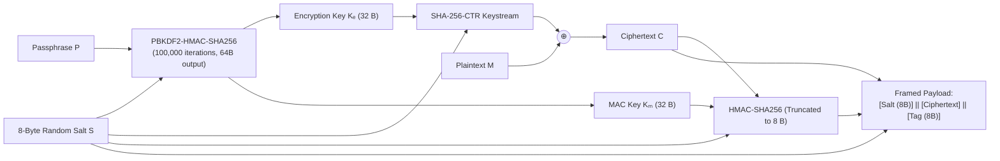
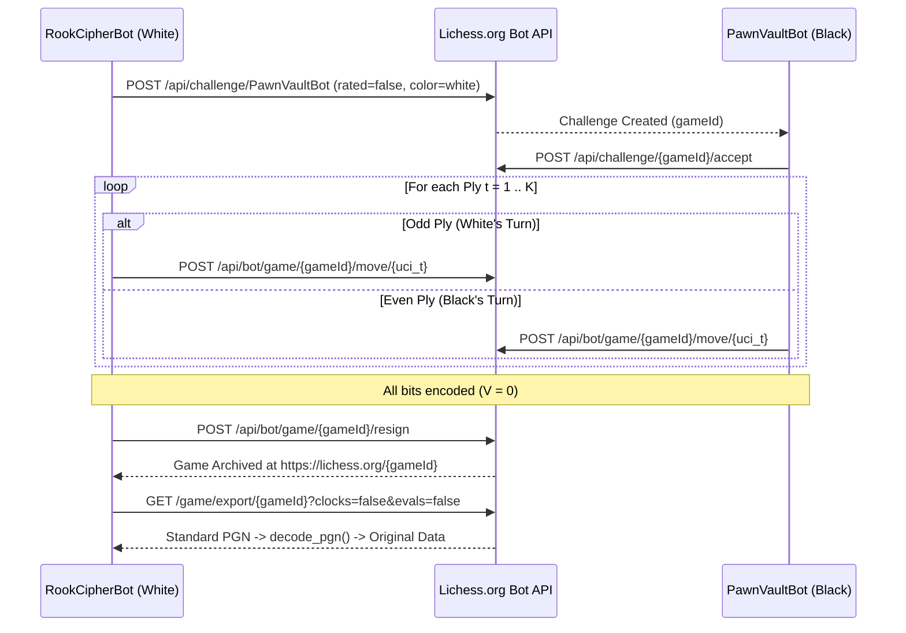

# ChessCrypt Technical Specification & Mathematical Guide 📐♟️

This document details the mathematical, cryptographic, and algorithmic internals of **ChessCrypt**: how arbitrary binary data is bijectively framed, optionally encrypted, mapped into a variable-radix legal chess move tree, and losslessly reconstructed from standard PGN archives.

---

## Table of Contents
1. [Combinatorial Steganography in Chess Game Trees](#1-combinatorial-steganography-in-chess-game-trees)
2. [Bijective Sentinel Framing (`0x01` Prefixing)](#2-bijective-sentinel-framing-0x01-prefixing)
3. [Authenticated Encryption Layer (PBKDF2 + SHA-256-CTR + HMAC)](#3-authenticated-encryption-layer-pbkdf2--sha-256-ctr--hmac)
4. [The Deterministic Position Move Dictionary](#4-the-deterministic-position-move-dictionary)
5. [Mixed-Radix Encoding & Decoding Algorithms](#5-mixed-radix-encoding--decoding-algorithms)
6. [Complete Worked Mathematical Trace: `"Hello World"`](#6-complete-worked-mathematical-trace-hello-world)
7. [Multi-Game Chunking & Capacity Analysis](#7-multi-game-chunking--capacity-analysis)
8. [Lichess Unrated Bot Match Protocol](#8-lichess-unrated-bot-match-protocol)

---

## 1. Combinatorial Steganography in Chess Game Trees

A chess game is a path through a directed acyclic state graph (when draw rules are enforced) rooted at the standard starting FEN:

$$\text{FEN}_0 = \texttt{rnbqkbnr/pppppppp/8/8/8/8/PPPPPPPP/RNBQKBNR w KQkq - 0 1}$$

At each half-move (ply) $t \ge 1$, the active player has $N_t$ safe legal moves available. Because $N_t$ varies dynamically with the board state ($N_1 = 20$ on Move 1, and typically $20 \le N_t \le 40$ in the middlegame), a sequence of $K$ plies spans a **mixed-radix number system** with radices $(N_1, N_2, \dots, N_K)$ and total state capacity:

$$\mathcal{C}(K) = \prod_{t=1}^{K} N_t \quad \text{states} \implies \sum_{t=1}^{K} \log_2(N_t) \quad \text{bits}$$

Wait-free fixed-bit schemes (e.g., taking only $\lfloor \log_2 N_t \rfloor$ bits per ply) waste up to $40\%$ of the available branching factor whenever $N_t$ is not a power of two (such as $N_1 = 20$, where $\lfloor \log_2 20 \rfloor = 4\text{ bits}$ wastes $\log_2(20) - 4 \approx 0.322\text{ bits/ply}$). ChessCrypt instead uses **full-precision big-integer mixed-radix arithmetic**, achieving $100\%$ of the theoretical Shannon capacity of the safe legal move set.

---

## 2. Bijective Sentinel Framing (`0x01` Prefixing)

Converting an arbitrary byte array $B = (b_0, b_1, \dots, b_{L-1}) \in \{0, \dots, 255\}^L$ directly into an unsigned big-endian integer collapses leading zero bytes (`0x00`), so `b"\x00\x41"` and `b"\x41"` would both map to $65$. Furthermore, an integer value of $0$ would terminate the mixed-radix division loop before encoding any moves.

To make the mapping $B \leftrightarrow V_0$ strictly **bijective** for all $B \in \{0, \dots, 255\}^*$ (including the empty byte string `b""` and payloads starting with arbitrary runs of `0x00`):

### Forward Mapping (`bytes_to_bigint`)
Prepend a single `0x01` sentinel byte before big-endian integer conversion:

$$V_0 = 2^{8L} + \sum_{k=0}^{L-1} b_k \cdot 2^{8(L - 1 - k)} = \operatorname{int\_from\_bytes}(\texttt{0x01} \,\|\, B)$$

**Properties:**
1. $V_0 \ge 1$ for every byte string $B$ (for $B = \texttt{b""}$, $V_0 = 1$).
2. The bit-length of $V_0$ is always $8L + 1$, uniquely encoding both the byte length $L$ and every byte value $b_k$.

### Inverse Mapping (`bigint_to_bytes`)
Given the reconstructed integer $V_0 \ge 1$:
1. Serialize $V_0$ to a big-endian byte array of length $\lceil \operatorname{bit\_length}(V_0) / 8 \rceil = L + 1$.
2. Verify that the leading byte equals `0x01`.
3. Strip the leading `0x01` byte to recover $B$ losslessly.

---

## 3. Authenticated Encryption Layer (PBKDF2 + SHA-256-CTR + HMAC)

When a passphrase $P$ is supplied (`--passphrase`), the raw plaintext $M$ is encrypted and authenticated **before** mixed-radix move encoding ([chesscrypt/crypto.py](file:///C:/Users/ramon/Documents/GitHub/ChessCrypt/chesscrypt/crypto.py)):

1. **Key Derivation:**
   $$(K_e, K_m) = \operatorname{PBKDF2-HMAC-SHA256}(P, S, c=100{,}000, \text{dkLen}=64)$$
2. **Stream Encryption (SHA-256-CTR):**
   For block index $j = 0, 1, \dots$:
   $$K_{\text{stream}, j} = \operatorname{SHA256}(K_e \,\|\, S \,\|\, \operatorname{uint32\_be}(j)), \qquad C = M \oplus K_{\text{stream}}$$
3. **Authentication Tag (Encrypt-then-MAC):**
   $$T = \operatorname{HMAC-SHA256}(K_m, S \,\|\, C)_{0..7}$$
   Upon decoding a game, $T$ is verified in constant time (`hmac.compare_digest`). If a single move in the PGN was altered or the passphrase is wrong, `CryptoError` is raised immediately.

---

## 4. The Deterministic Position Move Dictionary

At every ply $t$, both the encoder and decoder construct an identical, zero-indexed **Position Move Dictionary** $\mathcal{D}(\text{board}_t) = [m_0, m_1, \dots, m_{N_t - 1}]$ ([chesscrypt/dictionary.py](file:///C:/Users/ramon/Documents/GitHub/ChessCrypt/chesscrypt/dictionary.py)):

1. **Candidate Enumeration:** Generate all legal moves in $\text{board}_t$.
2. **1-Ply Safe Continuation Lookahead (`_is_safe_continuation`):**
   A candidate move $m$ is marked **safe** if and only if:
   - Pushing $m$ does **not** terminate the game (`not board.is_game_over(claim_draw=True)` — ruling out checkmate, stalemate, insufficient material, 75/50-move rule, and threefold repetition), **AND**
   - In the resulting position, the opponent has **at least one legal reply** $r$ that also does not terminate the game.
   *(If every legal move is terminal in a deep endgame, the filter gracefully falls back to non-terminal moves and then all legal moves.)*
3. **Canonical Lexicographical UCI Ordering:**
   All safe moves are sorted strictly by their UCI string representation (`from_square + to_square + promotion`, e.g., `a2a3 < a2a4 < b1a3 < b1c3 < ... < h2h4`).

### Complete Opening Dictionary Reference (Ply 1 & Ply 2)

| Index (`i`) | Ply 1 (White, Starting FEN, $N_1 = 20$) | Ply 2 (Black after `1. d3`, $N_2 = 20$) |
| :---: | :--- | :--- |
| **`0`** | `a2a3` (**a3** — Pawn) | `a7a5` (**a5** — Pawn) |
| **`1`** | `a2a4` (**a4** — Pawn) | `a7a6` (**a6** — Pawn) |
| **`2`** | `b1a3` (**Na3** — Knight) | `b7b5` (**b5** — Pawn) |
| **`3`** | `b1c3` (**Nc3** — Knight) | **`b7b6` (b6 — Pawn)** $\leftarrow i_2 = 3$ |
| **`4`** | `b2b3` (**b3** — Pawn) | `b8a6` (**Na6** — Knight) |
| **`5`** | `b2b4` (**b4** — Pawn) | `b8c6` (**Nc6** — Knight) |
| **`6`** | `c2c3` (**c3** — Pawn) | `c7c5` (**c5** — Pawn) |
| **`7`** | `c2c4` (**c4** — Pawn) | `c7c6` (**c6** — Pawn) |
| **`8`** | **`d2d3` (d3 — Pawn)** $\leftarrow i_1 = 8$ | `d7d5` (**d5** — Pawn) |
| **`9`** | `d2d4` (**d4** — Pawn) | `d7d6` (**d6** — Pawn) |
| **`10`** | `e2e3` (**e3** — Pawn) | `e7e5` (**e5** — Pawn) |
| **`11`** | `e2e4` (**e4** — Pawn) | `e7e6` (**e6** — Pawn) |
| **`12`** | `f2f3` (**f3** — Pawn) | `f7f5` (**f5** — Pawn) |
| **`13`** | `f2f4` (**f4** — Pawn) | `f7f6` (**f6** — Pawn) |
| **`14`** | `g1f3` (**Nf3** — Knight) | `g7g5` (**g5** — Pawn) |
| **`15`** | `g1h3` (**Nh3** — Knight) | `g7g6` (**g6** — Pawn) |
| **`16`** | `g2g3` (**g3** — Pawn) | `g8f6` (**Nf6** — Knight) |
| **`17`** | `g2g4` (**g4** — Pawn) | `g8h6` (**Nh6** — Knight) |
| **`18`** | `h2h3` (**h3** — Pawn) | `h7h5` (**h5** — Pawn) |
| **`19`** | `h2h4` (**h4** — Pawn) | `h7h6` (**h6** — Pawn) |

---

## 5. Mixed-Radix Encoding & Decoding Algorithms

### Encoding Recurrence
Starting from $V_1 = V_0 \ge 1$ and the initial board state $\text{board}_1$:

For ply $t = 1, 2, \dots$ while $V_t > 0$:
1. Compute the Position Move Dictionary $\mathcal{D}_t = \mathcal{D}(\text{board}_t)$ and its radix $N_t = |\mathcal{D}_t|$.
2. Extract the remainder index and next quotient:
   $$i_t = V_t \bmod N_t, \qquad V_{t+1} = \lfloor V_t / N_t \rfloor$$
3. Select move $m_t = \mathcal{D}_t[i_t]$ and push $m_t$ onto the board to obtain $\text{board}_{t+1}$.
4. Terminate when $V_{t+1} = 0$ (letting $K = t$ be the final ply).

> **Forced Single-Reply Check Handling ($N_t = 1$):**  
> If a player is placed in check such that only $N_t = 1$ legal evasion move exists, $i_t = V_t \bmod 1 = 0$ and $V_{t+1} = \lfloor V_t / 1 \rfloor = V_t$. The forced move carries $\log_2(1) = 0\text{ bits}$ of information, advances the board out of check, and preserves $V_t$ intact for ply $t+1$.

### Decoding Recurrence (Uniqueness Proof)
Notice that at the final ply $K$, $1 \le V_K < N_K$ (otherwise $V_{K+1} = \lfloor V_K / N_K \rfloor$ would not be $0$). Therefore, the terminal remainder $i_K = V_K \bmod N_K = V_K$ is strictly non-zero ($i_K \ge 1$), so there is zero trailing-zero ambiguity in the move sequence length $K$.

Given the observed move sequence $(m_1, m_2, \dots, m_K)$:
1. Initialize accumulator $A_0 = 0$ and radix product multiplier $M_1 = 1$.
2. For each ply $t = 1, \dots, K$:
   - Construct $\mathcal{D}_t = \mathcal{D}(\text{board}_t)$ with radix $N_t = |\mathcal{D}_t|$.
   - Locate the unique index $i_t \in \{0, \dots, N_t - 1\}$ such that $\mathcal{D}_t[i_t] = m_t$.
   - Update:
     $$A_t = A_{t-1} + i_t \cdot M_t, \qquad M_{t+1} = M_t \cdot N_t$$
   - Push $m_t$ to obtain $\text{board}_{t+1}$.
3. At ply $K$, $A_K = \sum_{t=1}^{K} i_t \prod_{j=1}^{t-1} N_j = V_0$.

---

## 6. Complete Worked Mathematical Trace: `"Hello World"`

### Input Conversion
- **Plaintext:** `"Hello World"` ($11\text{ bytes}$)
- **UTF-8 Hex:** `48 65 6c 6c 6f 20 57 6f 72 6c 64`
- **Sentinel-Prefixed Hex (`12 bytes = 96 bits`):** `01 48 65 6c 6c 6f 20 57 6f 72 6c 64`
- **Initial BigInt ($V_0$):**
  $$V_0 = \mathtt{0x0148656c6c6f20576f726c64}_{16} = \mathbf{39,700,662,791,022,760,251,689,6868}_{10}$$

### Step-by-Step Division & Move Selection ($t = 1 \dots 20$)

| Ply $t$ | Turn | Radix $N_t$ | Input Value $V_t$ | Index $i_t = V_t \bmod N_t$ | Chosen Move (UCI / SAN) | Next Quotient $V_{t+1} = \lfloor V_t / N_t \rfloor$ | Cumulative Multiplier $M_t = \prod_{j<t} N_j$ |
| :-: | :-: | :-: | :--- | :-: | :-: | :--- | :--- |
| **1** | W | 20 | `397006627910227602516896868` | **`8`** | `d2d3` (**1. d3**) | `19850331395511380125844843` | `1` |
| **2** | B | 20 | `19850331395511380125844843` | **`3`** | `b7b6` (**1... b6**) | `992516569775569006292242` | `20` |
| **3** | W | 27 | `992516569775569006292242` | **`19`** | `f2f3` (**2. f3**) | `36759872954650703936749` | `400` |
| **4** | B | 21 | `36759872954650703936749` | **`13`** | `f7f5` (**2... f5**) | `1750470140697652568416` | `10,800` |
| **5** | W | 26 | `1750470140697652568416` | **`14`** | `d1d2` (**3. Qd2**) | `67325774642217406477` | `226,800` |
| **6** | B | 21 | `67325774642217406477` | **`1`** | `a7a6` (**3... a6**) | `3205989268677019356` | `5,896,800` |
| **7** | W | 27 | `3205989268677019356` | **`6`** | `c2c3` (**4. c3**) | `118740343284334050` | `123,832,800` |
| **8** | B | 19 | `118740343284334050` | **`5`** | `c7c6` (**4... c6**) | `6249491751807055` | `3,343,485,600` |
| **9** | W | 23 | `6249491751807055` | **`6`** | `d2c2` (**5. Qc2**) | `271717032687263` | `63,526,226,400` |
| **10** | B | 18 | `271717032687263` | **`17`** | `h7h6` (**5... h6**) | `15095390704847` | `1,461,103,207,200` |
| **11** | W | 28 | `15095390704847` | **`19`** | `e1f2` (**6. Kf2**) | `539121096601` | `26,299,857,729,600` |
| **12** | B | 17 | `539121096601` | **`7`** | `d8c7` (**6... Qc7**) | `31713005682` | `736,396,016,428,800` |
| **13** | W | 27 | `31713005682` | **`0`** | `a2a3` (**7. a3**) | `1174555766` | `12,518,732,279,289,600` |
| **14** | B | 25 | `1174555766` | **`16`** | `e7e6` (**7... e6**) | `46982230` | `338,005,771,540,819,200` |
| **15** | W | 26 | `46982230` | **`22`** | `g2g3` (**8. g3**) | `1807008` | `8,450,144,288,520,480,000` |
| **16** | B | 30 | `1807008` | **`18`** | `f5f4` (**8... f4**) | `60233` | `219,703,751,501,532,480,000` |
| **17** | W | 25 | `60233` | **`8`** | `c2a4` (**9. Qa4**) | `2409` | `6,591,112,545,045,974,400,000` |
| **18** | B | 28 | `2409` | **`1`** | `a8a7` (**9... Ra7**) | `86` | `164,777,813,626,149,360,000,000` |
| **19** | W | 32 | `86` | **`22`** | `e2e4` (**10. e4**) | `2` | `4,613,778,781,532,182,080,000,000` |
| **20** | B | 29 | `2` | **`2`** | `a7b7` (**10... Rb7**) | **`0`** | `147,640,921,009,029,826,560,000,000` |

### Reverse Reconstruction Verification
Summing $i_t \cdot M_t$ from $t = 1$ to $20$:

$$\begin{aligned}
V_0 &= 8(1) + 3(20) + 19(400) + 13(10{,}800) + \dots + 22(4.6137\times 10^{24}) + 2(1.4764\times 10^{26}) \\
    &= \mathbf{39,700,662,791,022,760,251,689,6868} \\
    &= \mathtt{0x0148656c6c6f20576f726c64}_{16} \xrightarrow{\text{strip } \mathtt{0x01}} \texttt{"Hello World"}
\end{aligned}$$

---

## 7. Multi-Game Chunking & Capacity Analysis

- **Default Chunk Size (`DEFAULT_MAX_CHUNK_BYTES = 32`):**
  A 32-byte chunk ($+1\text{ sentinel byte} = 264\text{ bits}$) requires roughly $264 / 4.7 \approx 56\text{ plies}$ ($28\text{ full moves}$), keeping every game short, fast to play over the Lichess Bot API, and well below the 50-move draw limit.
- **Multi-Game Splitting:**
  Payloads exceeding `max_chunk_bytes` are partitioned into ordered chunks $C_1, C_2, \dots, C_G$. Each chunk $C_g$ is encoded as an independent legal game tagged with PGN header `[Round "g/G"]`. During decoding, `decode_pgn` or `decode_games` decodes each game $g$ back into $C_g$, concatenates $C_1 \,\|\, C_2 \,\|\, \dots \,\|\, C_G$, and passes the reassembled payload to `decrypt_payload`.

---

## 8. Lichess Unrated Bot Match Protocol

1. **Bot Upgrade Prerequisite:** Both accounts must have $0$ prior human games played and be upgraded once via `POST /api/bot/account/upgrade` (`python -m chesscrypt setup-bots`).
2. **Hardcoded Unrated Enforcement:** `LichessBotClient.create_challenge` rejects `rated=True` with a `ValueError` and always transmits `rated="false"`. This guarantees compliance with Lichess Fair Play guidelines by never touching rated matchmaking pools.
